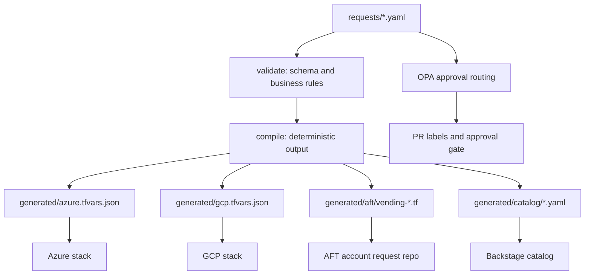

# Multicloud Account, Subscription and Project Vending Machine

**Request-as-code for AWS, Azure and GCP: one request format, policy-routed approvals, reviewed creation, and sandboxes that expire into quarantine. Terraform plus Backstage.**


Companion to [landing-zone-multicloud-parity](https://github.com/Adamson-lab/landing-zone-multicloud-parity) (project 1): that repository defines the guardrails; this one controls how governed containers are created.

## 1. Executive summary

Creating a cloud account, subscription or project is usually a ticket and console work. The result is inconsistent metadata, missing budgets, forgotten sandboxes and no single record of who approved what. This repository turns the request into a validated file in Git, decides required approvers by policy, creates the container through a reviewed pipeline with federated credentials, and moves expired sandboxes into quarantine instead of deleting them.

It is honest about where the clouds differ: AWS accounts go through Account Factory for Terraform so Control Tower governs them; Azure subscriptions and GCP projects are created by Terraform stacks.

## 2. Business context

| Item | Statement |
|---|---|
| Problem | Slow, inconsistent, hard-to-audit container creation and sandbox sprawl |
| Stakeholders | Workload teams, platform, security, finance, compliance, architecture board, auditors |
| Drivers | Audit evidence, delivery speed, spend control, sandbox hygiene |
| Constraints | Landing zone uses Control Tower; billing scopes and OIDC trust are organization specific |
| Success metrics (proposed targets) | Request-to-ready time; containers created outside the pipeline; containers with owner and budget; sandboxes past expiry |

## 3. Architecture at a glance



All 15 views: [docs/03-architecture-views/architecture-views.md](docs/03-architecture-views/architecture-views.md).

## 4. Key design decisions

| ADR | Decision | Rejected alternative |
|---|---|---|
| [0001](docs/04-adr/0001-git-as-system-of-record.md) | Pull requests are the system of record | ITSM ticket or database behind a portal |
| [0002](docs/04-adr/0002-backstage-thin-front-door.md) | Backstage is a thin front door, no custom action | Custom portal or duplicated validation |
| [0003](docs/04-adr/0003-compile-to-tfvars-for-each.md) | Compile to tfvars and use for_each | Module per request, Terragrunt, Crossplane |
| [0004](docs/04-adr/0004-state-per-cloud-sharding.md) | One state per cloud with a sharding trigger | One state, or state per request |
| [0005](docs/04-adr/0005-aws-via-aft.md) | AWS accounts through AFT | Organizations API directly |
| [0006](docs/04-adr/0006-soft-delete-and-prevent-destroy.md) | Quarantine first, manual deletion | Delete on removal or at expiry |
| [0007](docs/04-adr/0007-approval-routing-as-code.md) | Approval routing in Rego | CODEOWNERS only or manual triage |
| [0008](docs/04-adr/0008-single-place-for-business-rules.md) | Business rules in one place | Rules re-implemented in the portal |
| [0009](docs/04-adr/0009-federated-credentials-split-identities.md) | OIDC with split plan and apply identities | Static keys or one identity |
| [0010](docs/04-adr/0010-generated-artefacts-committed-and-checked.md) | Generated files committed and verified | Generate only at apply time |

## 5. Scope

- **In scope:** request contract, validation, approval routing, compile to Terraform and AFT inputs, Azure and GCP creation modules, AWS baseline customization, Backstage template and catalog entities, sandbox expiry, runbooks, business-case model.
- **Out of scope:** guardrails (project 1), networking, workload deployment, automatic deletion, owner directory validation.
- **Assumptions:** Control Tower and AFT exist for AWS; billing scopes are available; landing zone outputs include management group IDs and folder IDs (with a `decommissioned` key for each).

## 6. Technology stack and why

| Component | Choice | Why |
|---|---|---|
| Engine | Python 3.10+ (`vendingctl`) | Testable rules and generators |
| Contract | JSON Schema plus rules | Shared by engine and portal |
| Policy | Open Policy Agent (Rego) | Explainable approval routing, unit tested |
| IaC | OpenTofu or Terraform HCL | One language across providers |
| AWS creation | Account Factory for Terraform | Keeps accounts under Control Tower |
| Portal | Backstage scaffolder, built-in actions | No new application to build |
| CI | GitHub Actions with OIDC | No static cloud credentials |

## 7. Quick start (no cloud credentials needed)

```bash
git clone https://github.com/Adamson-lab/vending-machine-multicloud-backstage && cd vending-machine-multicloud-backstage
python -m venv .venv && . .venv/bin/activate        # on Windows PowerShell: .venv\Scripts\Activate.ps1
pip install -e ".[dev]"
vendingctl validate                 # check all requests
vendingctl compile                  # regenerate generated/
python -m pytest -q                 # tests (Terraform logic tests need tofu or terraform; Rego tests need opa)
python scripts/effort_model.py      # business-case structure (placeholder inputs)
```

Optional tooling: `opa`, `tofu` (or `terraform`), Node 20 for `npm install && npm run validate:backstage`. Without `opa` and `tofu`, the tests that need them are skipped (15 of 104), so install both for the full suite.
Applying to real clouds is described in [docs/07-operations/runbooks.md](docs/07-operations/runbooks.md) (RB-01).

## 8. Repository map

| Path | Content |
|---|---|
| `requests/` | One YAML per workload and environment (examples included) |
| `schema/`, `config/` | Request schema, configuration schema and placeholder configuration |
| `src/vendingctl/` | Rules, compiler, expiry, approval helpers, CLI |
| `generated/` | Committed, verified outputs: tfvars, AFT requests, catalog entities |
| `infra/modules/`, `infra/stacks/` | Azure, GCP and AWS baseline modules; stacks that load generated inputs |
| `policies/` | Approval policy, team map, tests |
| `backstage/` | Software template, skeleton, app-config snippet |
| `scripts/` | Doc generation, Terraform logic harness, validators, effort model |
| `diagrams/`, `docs/` | Diagram sources and documentation set |
| `evidence/` | Captured outputs of the checks |

## 9. Non-functional targets

| Quality | Target | Evidence |
|---|---|---|
| Injection resistance | No request value becomes executable HCL | Regression tests |
| Safety | Removing a request deletes nothing | `prevent_destroy`, ADR 0006 |
| Determinism | Same input, identical output | Compile tests and CI check |
| Least privilege | Pull requests never hold write credentials | Workflow design, `actionlint` |
| Consistency | Portal equals schema | Drift tests |

## 10. Cost, security, operations, testing

- Business case: [docs/08-cost-and-finance/business-case.md](docs/08-cost-and-finance/business-case.md)
- Threat model: [docs/06-security/threat-model.md](docs/06-security/threat-model.md)
- Runbooks: [docs/07-operations/runbooks.md](docs/07-operations/runbooks.md)
- Test strategy and status: [docs/10-testing/test-strategy.md](docs/10-testing/test-strategy.md)

## 11. Validation status (read this)

| Check | Status |
|---|---|
| Request rules, compiler, expiry, approvals logic | Unit tested |
| Injection resistance in generated HCL | Regression tested (a real flaw was found and fixed during the build) |
| Approval routing (Rego) | Unit tested and tested end to end on example requests |
| Azure and GCP module logic and variable validation | Evaluated without providers, positive and negative cases |
| Backstage template and catalog entities | Validated against Backstage's own schemas; negative test proves rejection |
| Portal and schema consistency | Tested |
| Workflows | `actionlint` clean |
| Diagrams | All parse |
| Azure and GCP provider schemas (`tofu validate` with providers) | **Not run here** |
| Real billing scopes, AFT, OIDC trust, any live apply | **Not done**: sandbox first |

## 12. Trade-offs and known limitations

- Effort alone does not justify this at low volume; see the break-even analysis.
- AWS creation is delegated to AFT, so this repository does not itself create AWS accounts.
- Approval gate relies on GitHub team membership and a read:org token; administrators can bypass unless rulesets apply to them.
- The owner field is not yet validated against an identity directory.
- Depends on landing zone outputs (management group IDs, folder IDs including `decommissioned`).
- Business-case inputs are placeholders.

## 13. Roadmap

See [ROADMAP.md](ROADMAP.md).

## 14. Contributing and contact

See [CONTRIBUTING.md](CONTRIBUTING.md) and [SECURITY.md](SECURITY.md).

## 15. License

MIT.
