# Architecture views

<!-- GENERATED by scripts/build_docs.py from diagrams/*.mmd. Do not edit by hand. -->

Diagram sources are in `diagrams/`.

| ID | View | Audience |
|---|---|---|
| D01 | System context | Business, architects |
| D02 | Container architecture | Architects, engineers |
| D03 | Request lifecycle sequence | Workload teams, engineers |
| D04 | Request state machine | Engineers, auditors |
| D05 | Approval routing | Approvers, governance |
| D06 | State layout and blast radius | Engineers, operations |
| D07 | AWS Account Factory flow | Engineers, security |
| D08 | Pipeline credentials | Security, engineers |
| D09 | Expiry and decommissioning | Operations, finance |
| D10 | Failure and dependency view | Operations, risk |
| D11 | Backstage integration | Platform, developers |
| D12 | Delivery roadmap | Executives, programme |
| D13 | Conceptual data model | Architects, data |
| D14 | Current, transition and target state | Executives, architects |
| D15 | Capability map | Business, executives |

## D01 System context

**Purpose:** Who uses the vending machine and which systems it touches.  
**Audience:** Business, architects  
**Source:** `diagrams/D01-system-context.mmd`

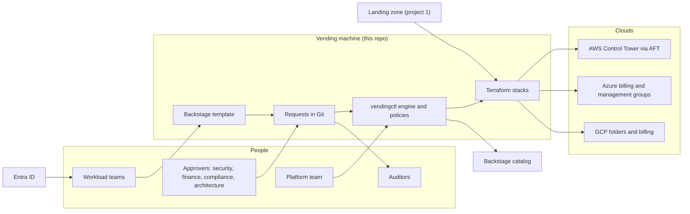

## D02 Container architecture

**Purpose:** How a request becomes Terraform inputs, AFT requests and catalog entries.  
**Audience:** Architects, engineers  
**Source:** `diagrams/D02-architecture.mmd`

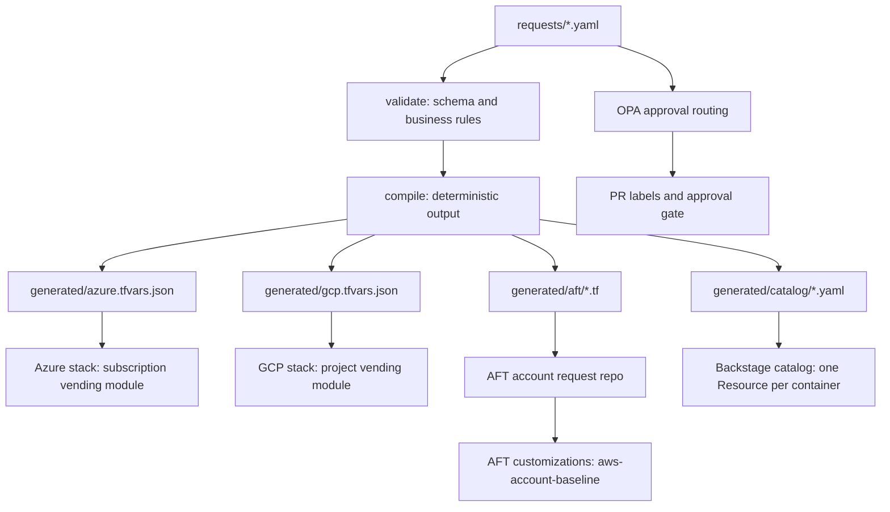

## D03 Request lifecycle sequence

**Purpose:** From portal form to provisioned container, with validation, approval and apply.  
**Audience:** Workload teams, engineers  
**Source:** `diagrams/D03-request-lifecycle-sequence.mmd`

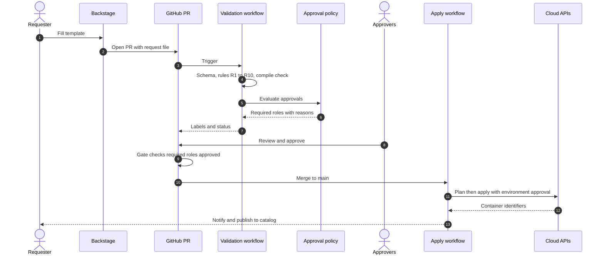

## D04 Request state machine

**Purpose:** The states a request can be in and what moves it.  
**Audience:** Engineers, auditors  
**Source:** `diagrams/D04-request-state-machine.mmd`

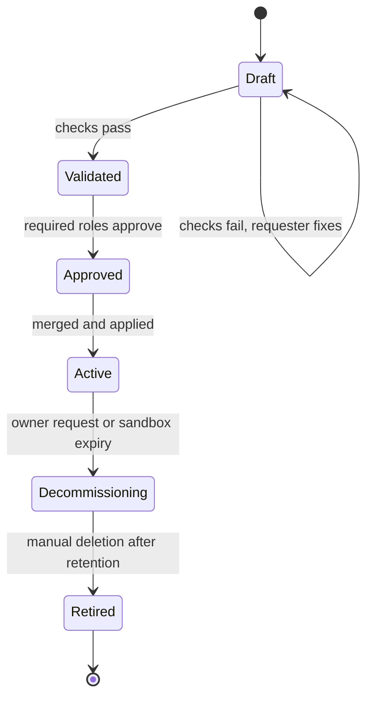

## D05 Approval routing

**Purpose:** Which approver roles a request triggers.  
**Audience:** Approvers, governance  
**Source:** `diagrams/D05-approval-routing.mmd`

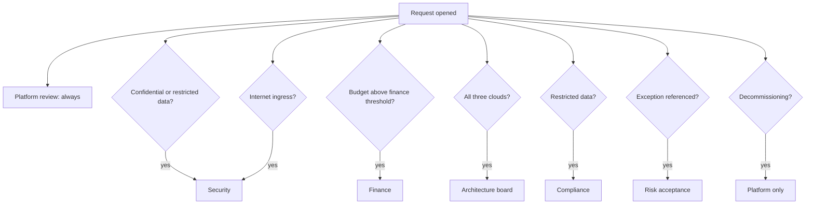

## D06 State layout and blast radius

**Purpose:** One state per cloud and the sharding trigger.  
**Audience:** Engineers, operations  
**Source:** `diagrams/D06-state-and-blast-radius.mmd`

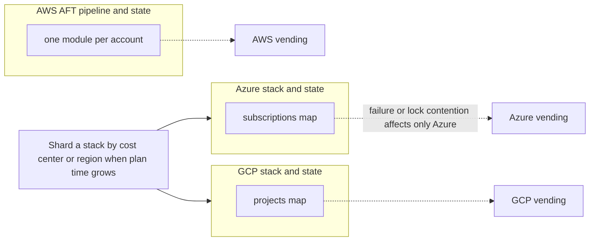

## D07 AWS Account Factory flow

**Purpose:** Why AWS accounts go through AFT and Control Tower.  
**Audience:** Engineers, security  
**Source:** `diagrams/D07-aws-aft-flow.mmd`

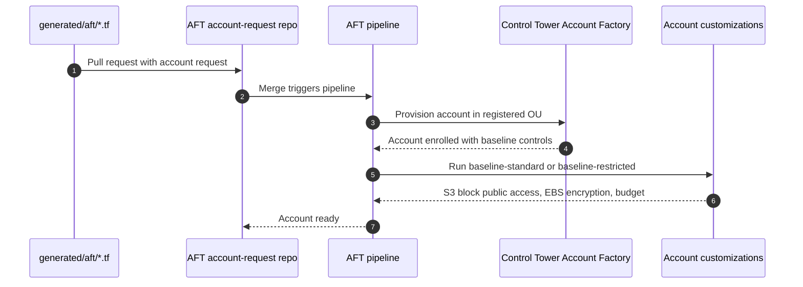

## D08 Pipeline credentials

**Purpose:** Federated credentials with separate plan and apply identities.  
**Audience:** Security, engineers  
**Source:** `diagrams/D08-credentials-flow.mmd`

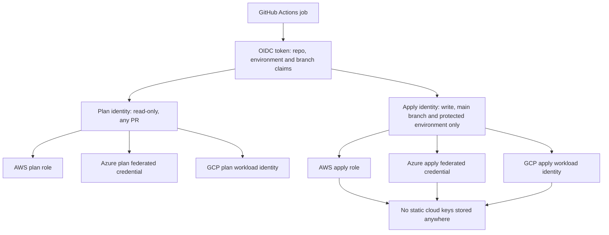

## D09 Expiry and decommissioning

**Purpose:** Sandbox expiry, quarantine and manual deletion.  
**Audience:** Operations, finance  
**Source:** `diagrams/D09-decommission-flow.mmd`

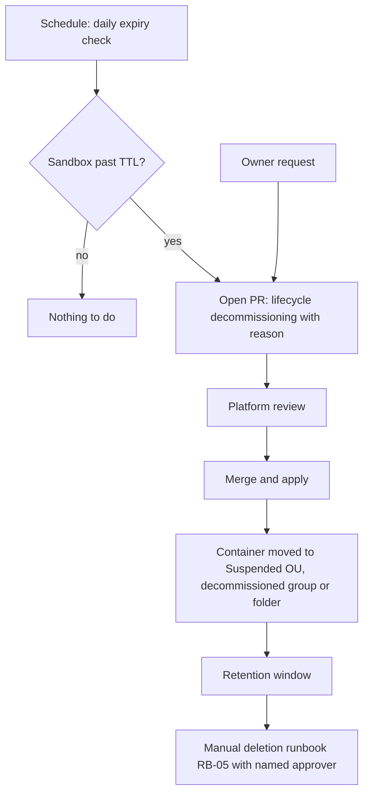

## D10 Failure and dependency view

**Purpose:** What breaks when each dependency fails.  
**Audience:** Operations, risk  
**Source:** `diagrams/D10-failure-dependencies.mmd`

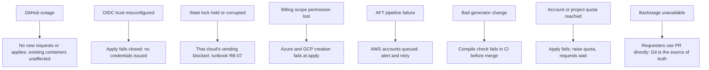

## D11 Backstage integration

**Purpose:** Template, built-in actions and catalog publication.  
**Audience:** Platform, developers  
**Source:** `diagrams/D11-backstage-integration.mmd`

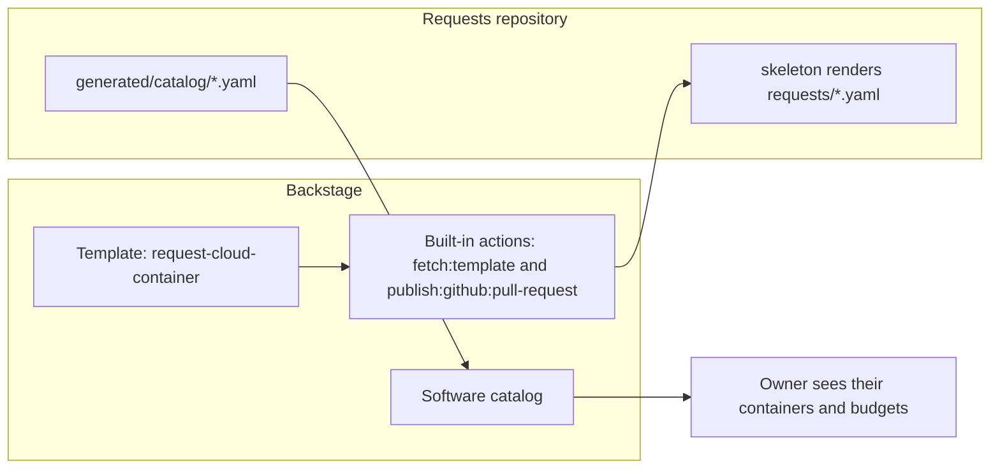

## D12 Delivery roadmap

**Purpose:** Indicative sequencing. Dates are planning placeholders.  
**Audience:** Executives, programme  
**Source:** `diagrams/D12-roadmap.mmd`

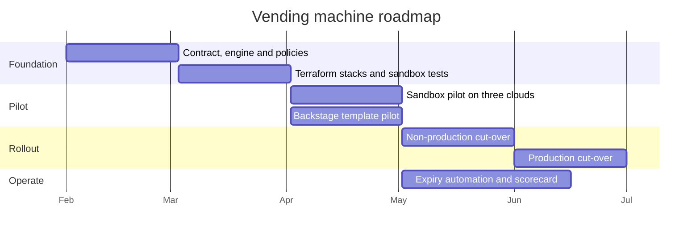

## D13 Conceptual data model

**Purpose:** Request, placement, approval, exception, catalog resource.  
**Audience:** Architects, data  
**Source:** `diagrams/D13-data-model.mmd`

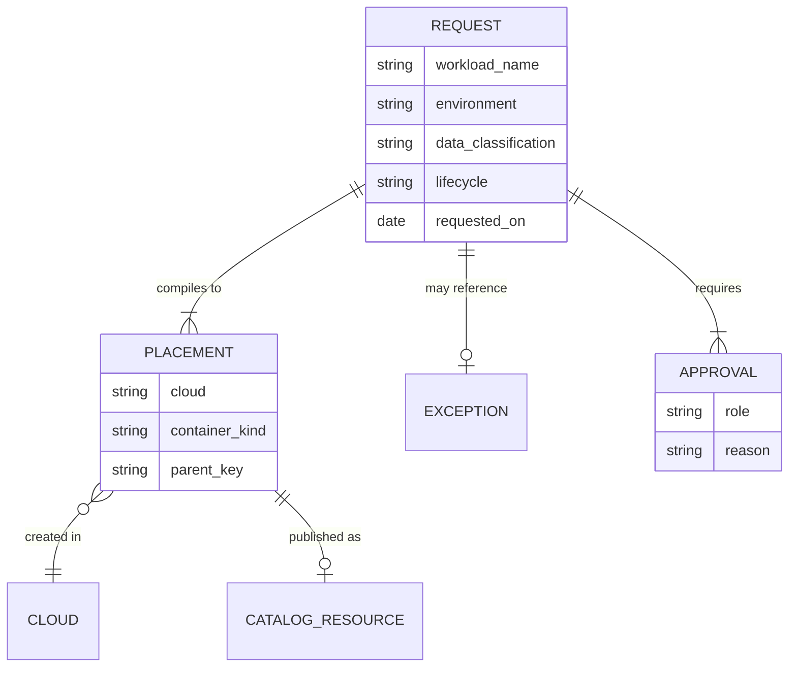

## D14 Current, transition and target state

**Purpose:** Why adoption is staged.  
**Audience:** Executives, architects  
**Source:** `diagrams/D14-current-target-transition.mmd`

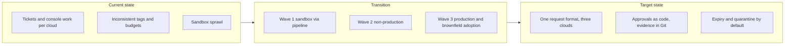

## D15 Capability map

**Purpose:** Capabilities the vending machine provides.  
**Audience:** Business, executives  
**Source:** `diagrams/D15-capability-map.mmd`

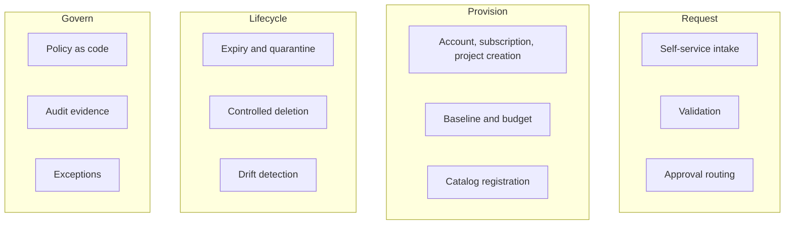
